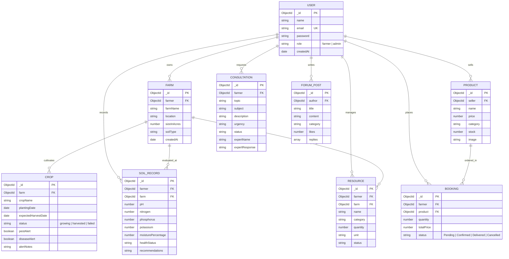

# 🌱 AgriTech — Digital Agriculture & Farmer Empowerment Platform

An enterprise-grade, full-stack MERN application empowering farmers with digital agro-services: Farm & Crop lifecycle tracking, Real-Time Meteorological Forecasts, Soil Health Monitoring with Agronomic Recommendations, Pest & Pathogen Threat Centers, Resource Management, Agricultural Marketplace & Order Processing, Expert Consultations, and Peer Community Discussions — secured by strict Role-Based Access Control (RBAC) with separate Farmer and Administrator portals.

---

## 📑 Table of Contents

- [Architectural Overview](#-architectural-overview)
- [Entity-Relationship Diagram (ERD)](#-entity-relationship-diagram-erd)
- [Portal Separation & Role-Based Access Control](#-portal-separation--role-based-access-control)
- [Feature Implementation Matrix](#-feature-implementation-matrix)
- [Tech Stack](#-tech-stack)
- [Directory Structure](#-directory-structure)
- [Local Development Setup](#-local-development-setup)
- [Environment Configuration](#-environment-configuration)
- [API Reference](#-api-reference)
- [Automated & Manual Testing](#-automated--manual-testing)
- [Production Deployment Guide](#-production-deployment-guide)

---

## 🏛️ Architectural Overview

The application is structured into a decoupled client-server architecture:

```
┌─────────────────────────────────────────────────────────────┐
│                       Client (React 19)                     │
│  ┌───────────────────────┐       ┌───────────────────────┐  │
│  │     Farmer Portal     │       │     Admin Console     │  │
│  │ (/login, /register,   │       │ (/admin/login,        │  │
│  │  /dashboard)          │       │  /admin/dashboard)    │  │
│  └───────────┬───────────┘       └───────────┬───────────┘  │
└──────────────┼───────────────────────────────┼──────────────┘
               │  HTTP / JSON + JWT Bearer     │
┌──────────────▼───────────────────────────────▼──────────────┐
│                    Backend Server (Express 5)               │
│  ┌───────────────────────────────────────────────────────┐  │
│  │ JWT Authentication & Dual Middleware (auth & admin)   │  │
│  └───────────────────────────────────────────────────────┘  │
│  ┌───────────────────────────────────────────────────────┐  │
│  │ Controllers: Auth, Farms, Crops, Soil, Resources,     │  │
│  │              Consultations, Forum, Products, Bookings │  │
│  └───────────────────────────────────────────────────────┘  │
└──────────────┬───────────────────────────────┬──────────────┘
               │ Mongoose ODM                  │ REST
┌──────────────▼──────────┐         ┌──────────▼──────────────┐
│  MongoDB Atlas Cluster  │         │   OpenWeather API 2.5   │
└─────────────────────────┘         └─────────────────────────┘
```

---

## 📊 Entity-Relationship Diagram (ERD)



---

## 🔐 Portal Separation & Role-Based Access Control

1. **Farmer Portal (`/login`, `/register`, `/dashboard`)**
   - Public registration strictly provisions accounts with `role: 'farmer'`.
   - Cannot access the Admin Portal or any `/api/admin/*` routes.
   - Comprehensive multi-tab farmer workspace for farm operations.

2. **Admin Console (`/admin/login`, `/admin/dashboard`)**
   - Distinct, restricted security UI.
   - Enforces server-side administrative verification (`user.role === 'admin'`). Farmer credentials attempting admin login are immediately rejected with `403 Forbidden`.
   - Full governance tools: User directory with role elevation/demotion, booking status updates, platform farm/crop audit, and marketplace product moderation.

3. **Backend Authorization Guarantee**
   - Does not trust localStorage or client-side claims.
   - Every protected request verifies the JWT signature and re-checks the live database record to prevent token tampering.

---

## ✅ Feature Implementation Matrix

| # | Skillwallet Requirement | Route / Endpoint | Status | Description |
|---|-------------------------|------------------|--------|-------------|
| 1 | **User Registration & Login** | `/login`, `/register`, `/api/auth` | **Completed** | Bcrypt password hashing, duplicate email checks, JWT tokens. |
| 2 | **Admin Authentication** | `/admin/login`, `/api/auth/admin-login` | **Completed** | Dedicated login route with strict 403 role enforcement. |
| 3 | **Farm Management** | `/dashboard` (Farms Tab), `/api/farms` | **Completed** | Full CRUD, acreage validation, cascade deletion of crops. |
| 4 | **Crop Management** | `/dashboard` (Crops Tab), `/api/crops` | **Completed** | Planting & harvest scheduling, soil association, alert flags. |
| 5 | **Weather Forecast** | `/dashboard` (Weather Tab), `/api/weather` | **Completed** | Live OpenWeatherMap integration (temp, humidity, wind, pressure). |
| 6 | **Soil Health Monitoring** | `/dashboard` (Soil Tab), `/api/soil` | **Completed** | Logs pH, NPK, moisture; auto-generates agronomic advice. |
| 7 | **Pest & Disease Threats** | `/dashboard` (Alerts Tab), `/api/crops` | **Completed** | Active threat monitoring center with immediate quarantine steps. |
| 8 | **Resource Management** | `/dashboard` (Resources Tab), `/api/resources` | **Completed** | Tracks water, fertilizers, seeds, machinery status and stock. |
| 9 | **Agricultural Marketplace** | `/dashboard` (Market Tab), `/api/products` | **Completed** | Products listing, seller ownership enforcement, price & stock. |
| 10 | **Booking & Order Processing**| `/dashboard` (Orders Tab), `/api/bookings` | **Completed** | Stock decrement on order, self-booking rejection, order history. |
| 11 | **Expert Consultation** | `/dashboard` (Expert Tab), `/api/consultations`| **Completed** | Agronomy inquiries categorized by domain with expert guidance. |
| 12 | **Community Forum** | `/dashboard` (Forum Tab), `/api/forum` | **Completed** | Peer questions, advice threads, replies, and helpful votes. |
| 13 | **Analytics & Reporting** | `/dashboard`, `/admin/dashboard` | **Completed** | High-level metrics for farm acreage, crops, orders, and revenue. |
| 14 | **Admin Platform Control** | `/admin/dashboard`, `/api/admin` | **Completed** | User role promotion, order status changes, content moderation. |

---

## 🛠️ Local Development Setup

### Prerequisites
- **Node.js**: v18 or higher (tested on Node v24.22.0)
- **npm**: v9 or higher (tested on npm 11.19.1)
- **MongoDB Atlas** or local MongoDB database instance

### 1. Server Configuration
```bash
cd server
npm install
cp .env.example .env
# Fill in your MONGO_URI, JWT_SECRET, and OPENWEATHER_API_KEY
npm run dev    # Starts with nodemon, or npm start for node
```

### 2. Client Configuration
```bash
cd ../client
npm install
cp .env.example .env
# Set VITE_API_URL=http://localhost:5000/api
npm run dev    # Starts Vite dev server on http://localhost:5173
```

### 3. Designate an Administrator
To elevate an existing user account to Administrator:
```bash
cd server
node scripts/seedAdmin.js <user-email-address>
```

---

## 🧪 Automated & Manual Testing

### Run Automated Backend Verification Suite
```bash
cd server
npm test
```
*Executes 16 end-to-end integration tests validating authentication, admin role blocking, farm/crop cascade deletion, soil advisory calculations, resources, orders, and forum interactions.*

### Run Frontend Production Build & Linting
```bash
cd client
npm run lint    # Verifies code cleanliness via oxlint (0 errors)
npm run build   # Validates Vite production bundle compilation
```

---

## 🚀 Production Deployment Guide

### Recommended Free-Tier Hosting:
1. **Backend Server**: [Render](https://render.com) (Web Service) or [Railway](https://railway.app).
   - Build Command: `npm install`
   - Start Command: `npm start`
   - Environment Variables:
     - `MONGO_URI`: Your MongoDB Atlas connection string.
     - `PORT`: `5000` (or platform default)
     - `JWT_SECRET`: Random 32+ character secret string.
     - `OPENWEATHER_API_KEY`: OpenWeather API key.
     - `CLIENT_URL`: Your deployed frontend URL (e.g. `https://your-agritech.vercel.app`).
2. **Frontend Client**: [Vercel](https://vercel.com) or [Netlify](https://netlify.com).
   - Build Command: `npm run build`
   - Output Directory: `dist`
   - Environment Variables:
     - `VITE_API_URL`: Your live backend API URL (e.g. `https://your-agritech-api.onrender.com/api`).
3. **Database**: [MongoDB Atlas](https://www.mongodb.com/atlas) (M0 Free Tier Cluster).
   - In Atlas Network Access, ensure IP Access List includes your backend server IP or `0.0.0.0/0` (with strong user credentials).

---

## 📄 License
MIT License. Developed for AgriTech & Skillwallet Portal Submission.

